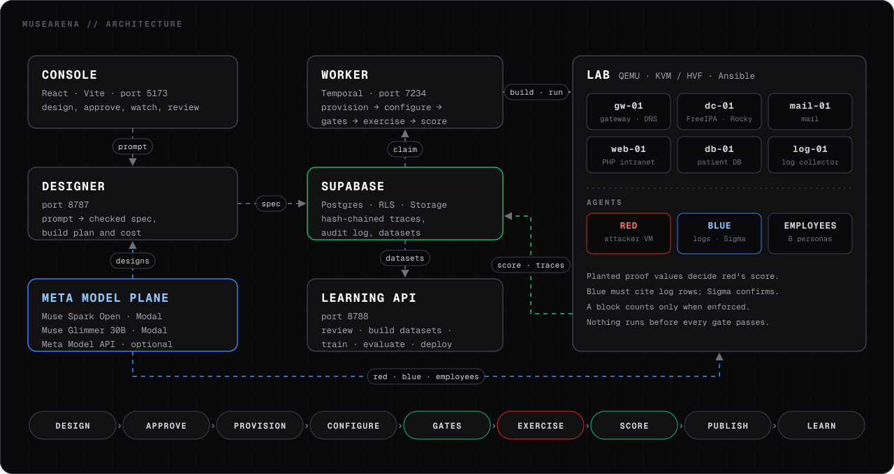

<p align="center">
  
</p>

<p align="center">
  <a href="LICENSE"></a>
  <a href="https://cerebralvalley.ai/e/meta-ai-developer-hackathon"></a>
  
  <a href="https://youtu.be/r4D9djKnZF8"></a>
</p>

<p align="center">
  <a href="#videos">Videos</a> ·
  <a href="#how-it-works">How it works</a> ·
  <a href="#build-and-run-locally">Build and run locally</a> ·
  <a href="#architecture">Architecture</a> ·
  <a href="#the-training-loop">Training loop</a>
</p>

# MuseArena

Turn a prompt into a live cyber range. Run scored attack and defense
exercises in it. Turn the results into training data for language models.

You describe an organization — a clinic network, a directory service, a
patient database, a weak web server. MuseArena designs the range, starts
real virtual machines, configures real services, and plants real
weaknesses. A red agent attacks. A blue agent defends. When it is over,
you get a score backed by evidence you can verify yourself, and a dataset
built from what actually happened.

Every number has a proof path. A claim without evidence does not count —
not in the score, not in the dataset, not anywhere.

## Videos

| Video | Contents |
|---|---|
| [MuseArena: AI red team vs. AI blue team](https://youtu.be/r4D9djKnZF8) | A 3-minute overview. It shows a full exercise from the design to the training data. |
| [MuseArena product walkthrough](https://youtu.be/MBkFCGPiqoU) | A screen recording of the console. It starts from an empty workspace and ends with a scored exercise. |

## Meta Global AI Developer Hackathon

MuseArena was built for the
[Meta Global AI Developer Hackathon](https://cerebralvalley.ai/e/meta-ai-developer-hackathon).

| | |
|---|---|
| **Hosts** | Meta and Cerebral Valley |
| **Format** | Remote, worldwide |
| **Dates** | October 26 to November 4, 2026 |
| **Goal** | Build with Meta's newest models in ten days |

### Meta models in MuseArena

| Model | Where it runs | What it does |
|---|---|---|
| Muse Spark Open (`meta-models/Muse-Spark-Open-816B-A42B`) | Self-hosted on Modal | Designs the lab. Plays the red agent and the blue agent. |
| Muse Glimmer 30B | Self-hosted on Modal (SGLang) | Plays the employee personas. |
| Meta Model API (`muse-spark-1.1` to `1.3`, `muse-wonder-1.0`) | Meta Model API (Responses API) | Optional model surface for all agent roles. |

The platform accepts models from Meta surfaces only. A fail-closed
allowlist in the code enforces this rule.

To prevent model hallucination, the platform does these checks:

- Blue must cite the log rows for each alert. Blue must use real ATT&CK
  technique IDs.
- Red cannot claim a success. Only a planted proof value counts.
- Employee agents use a fixed list of actions. They have no shell access.

## Contents

- [Videos](#videos)
- [Meta Global AI Developer Hackathon](#meta-global-ai-developer-hackathon)
- [How it works](#how-it-works)
- [What a run looks like](#what-a-run-looks-like)
- [Build and run locally](#build-and-run-locally)
- [Architecture](#architecture)
- [The training loop](#the-training-loop)
- [Evidence and integrity](#evidence-and-integrity)
- [Safety rules](#safety-rules)
- [Telemetry](#telemetry)
- [Contributing](#contributing)
- [Documentation](#documentation)
- [Security](#security)
- [License](#license)

## How it works

1. **Design.** You describe a scenario in a prompt. The designer makes a
   topology, picks services and weaknesses, and checks the cost against a
   budget. You can change the design before you approve it.
2. **Deploy.** The worker starts the machines on QEMU or Docker, configures
   them, and runs readiness checks. Nothing runs before the checks pass.
3. **Exercise.** A red agent tries to reach its objectives. A blue agent
   watches the logs and responds. Both act inside the range only.
4. **Score.** The platform matches each red action to ground truth. It
   counts objectives, points, detections, and false positives. The score
   comes from matched evidence, not from what an agent says about itself.
5. **Publish.** The platform stores a joined dataset of the run. The dataset
   is content-hashed and read-only. Raw traces are append-only and
   hash-chained, so no one can change history without detection.
6. **Learn.** You review traces, correct labels, build training datasets,
   and send them to a training run. A trained model must beat the base
   model on a held-out suite before it is deployed.

## What a run looks like

The six-guest clinic lab that ships with the demo (`backend/scripts/org-demo.mjs`):

| | |
|---|---|
| **Machines** | gateway/DNS, directory (FreeIPA), mail, intranet, patient DB, log collector |
| **People** | eight personas acting on the network — staff, admins, an outsider |
| **Attack** | red agent works toward three objectives mapped to MITRE ATT&CK techniques |
| **Defense** | blue agent watches auth and request logs, raises detections, blocks |
| **Output** | score report, joined trajectory dataset, Sigma detections, provenance |

A run takes about two minutes on an HVF-accelerated laptop, longer on
pure emulation. Every step of the pipeline — provision, configure,
readiness, gates, exercise, score, publish — is a checked stage with a
pass/fail state, not a best-effort attempt.

## Build and run locally

This procedure builds MuseArena on one computer. It starts the database,
the services, and the console. Then it runs a full exercise.

### Step 1: Get the tools

Install these tools before you start:

| Tool | Version | Use |
|---|---|---|
| Node.js | 18 or newer | Builds and runs all services |
| npm | 9 or newer | Installs the packages |
| Docker | Current | Runs the local Supabase stack and container labs |
| Supabase CLI | 2.117 or newer | Starts the local database |
| Temporal CLI | Current | Runs the workflow server for the worker |
| QEMU | Current | Starts the lab virtual machines |
| Ansible | Current | Configures the lab virtual machines |

For VM labs, the computer must have hardware acceleration:

- On macOS, QEMU uses HVF.
- On Linux, QEMU uses KVM. Make sure that your user can write to `/dev/kvm`.

Get these accounts and keys:

- A Clerk application. You need its publishable key for sign-in.
- Optional: Modal or Meta Model API keys. You need them only for model
  agents. Without them, the scripted agents and the fixed-seed design
  operate.

### Step 2: Get the code and build it

```sh
git clone https://github.com/Habib0x0/musearena.git
cd musearena
npm install
npm run build
```

The build compiles all workspaces. The backend output goes to
`backend/dist/`.

### Step 3: Start the database

```sh
cd backend
supabase start
cd ..
```

The first start applies all migrations in
`backend/supabase/migrations/`. The command shows the local API URL and
the keys. Keep this output for Step 4.

> **Note:** after a `git pull`, apply new migrations with
> `supabase migration up` in `backend/`.

### Step 4: Set the environment

1. Copy the example file:

   ```sh
   cp .env.example .env
   ```

2. In `.env`, set these values from the Step 3 output:

   | Name | Value |
   |---|---|
   | `SUPABASE_URL` | The local API URL |
   | `SUPABASE_SERVICE_ROLE_KEY` | The service role key |
   | `SUPABASE_ANON_KEY` | The anon key |
   | `CLERK_PUBLISHABLE_KEY` | Your Clerk publishable key |
   | `CLERK_SECRET_KEY` | Your Clerk secret key. Member management needs it. |

3. Create `frontend/.env.local` for the console. Set these values:

   | Name | Value |
   |---|---|
   | `VITE_CLERK_PUBLISHABLE_KEY` | Your Clerk publishable key |
   | `VITE_SUPABASE_URL` | The local API URL |
   | `VITE_SUPABASE_PUBLISHABLE_KEY` | The anon key |
   | `VITE_DESIGN_API_URL` | `http://127.0.0.1:8787` |
   | `VITE_LEARNING_API_URL` | `http://127.0.0.1:8788` |

4. Optional: for model agents, set the model surface keys in `.env`:
   - Modal: `MODAL_PROXY_TOKEN_ID`, `MODAL_PROXY_TOKEN_SECRET`,
     `MODAL_BASE_URL`, `MODAL_MODEL_ID`.
   - Meta Model API: `META_API_KEY`, `META_BASE_URL`, `META_MODEL_ID`.

> **Caution:** do not commit `.env` or `.env.local`. These files contain
> secrets. The `.gitignore` file excludes them.

### Step 5: Check the host

```sh
cd backend
node scripts/host-preflight.mjs
```

The report shows the acceleration type, the tool versions, and the
blockers. Correct all blockers before you continue.

> **Note:** an HVF host or a host without acceleration shows as
> development-only. Scored VM labs need native KVM. Use
> `--require-kvm` to make the check fail on other hosts.

### Step 6: Build the golden images (one time)

The workers boot from baked images. With these images, a lab does not
need package downloads at configuration time.

```sh
cd backend
node scripts/build-catalog-image.mjs     # Debian image for most hosts
node scripts/build-rocky-image.mjs       # Rocky 9 image for FreeIPA hosts
```

Each script boots a pinned cloud image once and installs the packages.
Then it writes the SHA512 to `backend/golden/`. The build needs network
access. A lab run does not.

> **Note:** a FreeIPA directory host needs the Rocky image. The platform
> does not boot a FreeIPA host from the Debian image.

### Step 7: Start the services

Open one terminal for each service. In each terminal, go to the
repository root and load `.env` first:

```sh
set -a && . ./.env && set +a
```

Then start one service in each terminal:

| Terminal | Command | Port |
|---|---|---|
| 1 | `temporal server start-dev --port 7234` | 7234 |
| 2 | `node backend/dist/designer/server.js` | 8787 |
| 3 | `node backend/dist/api/main.js` | 8788 |
| 4 | `node backend/dist/worker.js` | None |
| 5 | `cd frontend && npm run dev` | 5173 |

Start Temporal before the worker. The worker connects to
`localhost:7234`. To use a different server, set `TEMPORAL_ADDRESS`.

### Step 8: Run an exercise in the console

1. Open `http://localhost:5173`.
2. Sign in.
3. Go to **Designer**.
4. Describe an organization in plain English. Example: "A 12-person
   medical clinic with a gateway, a directory, mail, a PHP intranet, and
   a patient database."
5. Examine the design, the build plan, and the cost.
6. Acknowledge the cost. Then click **Approve & deploy**.
7. Go to **Environments** and monitor the build. The worker starts the
   machines, configures them, and runs the readiness checks.
8. When the checks pass, the exercise starts automatically.
9. When the exercise ends, go to **Exercises** to see the score. Go to
   **Red Team** and **Blue Team** to see the evidence.

### Step 9 (alternative): Run the demo without the console

The demo script builds the clinic lab, runs the exercise, and scores it.
It does not need the console, the designer, or Temporal.

```sh
cd backend
node scripts/org-demo.mjs                      # fixed-seed design, scripted agents
node scripts/org-demo.mjs --agents             # model agents (needs Modal keys)
node scripts/org-demo.mjs --prompt "<brief>"   # the model designs the lab
```

The script reads `.env` from the repository root. It writes the run to
`backend/captures/org-demo/<runId>/`.

To verify a recorded run offline, use the replay script. It needs no
VMs, no network, and no model:

```sh
node scripts/org-demo-replay.mjs captures/org-demo/<runId>
```

The script checks the dataset hash and scores the trace again. If the
result is different from the recorded score, the script fails.

### Problems and solutions

| Problem | Cause | Solution |
|---|---|---|
| The console shows "not configured". | The console cannot find a service URL. | Set `VITE_DESIGN_API_URL` and `VITE_LEARNING_API_URL`. Then restart `npm run dev`. |
| The console shows "Authentication is not configured". | `VITE_CLERK_PUBLISHABLE_KEY` is not set. | Set it in `frontend/.env.local`. Then restart `npm run dev`. |
| A deployment stays in `pending`. | The worker does not operate, or it cannot connect to the database or Temporal. | Examine the worker terminal. Make sure that Temporal operates on port 7234. |
| A FreeIPA host fails `profile-install`. | The Rocky golden image is not available. | Do Step 6 again for the Rocky image. |
| Training stops in `awaiting_trainer`. | No trainer endpoint is set. | Set `META_TRAINER_URL`. Or keep the run parked. A parked run never shows success. |

For more information, read [`docs/getting-started.md`](docs/getting-started.md)
and [`docs/learning-api.md`](docs/learning-api.md).

## Architecture

<p align="center">
  
</p>

### Software components

| Component | Technology | Role | Default port |
|---|---|---|---|
| Console | React 19, Vite, Tailwind CSS, Clerk | Web UI: design, approve, monitor, review | 5173 |
| Designer | Node.js, TypeScript | Turns a prompt into a checked spec, a build plan, and a cost estimate | 8787 |
| Learning API | Node.js, TypeScript | Review, datasets, training runs, evaluation, deployments | 8788 |
| Worker | Node.js, Temporal | Provisions, configures, gates, runs the exercise, scores, publishes | None |
| Temporal | Temporal server | Runs the deployment workflows for the worker | 7234 |
| Supabase | Postgres, row-level security, Storage | Specs, runs, hash-chained traces, audit log, datasets | 54321 |
| Lab hosts | QEMU (KVM or HVF), Ansible, Docker | The virtual machines of the range | None |
| Model plane | Muse Spark Open, Muse Glimmer 30B, Meta Model API | Designer, red, blue, and employee agents | None |

| Folder | Purpose |
|---|---|
| `backend/` | All server code: designer, worker, learning API, provisioner |
| `frontend/` | The web console that operators use |
| `shared/` | Contracts that both frontend and backend use |
| `deployment/` | Infrastructure code for platform services |
| `agent-guard/` | Local approval gateway for agent traffic and tool calls |

Packages are independent. They talk through `shared/` contracts only;
the frontend never imports backend code.

## The training loop

The part that makes it more than a range generator:

1. **Capture** traces from exercises — or import runs from an external
   harness with a capture key, tagged `imported` or `field` provenance.
2. **Review** — correct a label, or file a dispute and adjudicate it.
   Edits are overlays; the stored trace never changes.
3. **Build** a dataset by role (red/blue), technique, outcome, signal
   hit, or correction. Enforce a minimum share of real (non-synthetic)
   data. One scenario family cannot straddle train and test splits.
4. **Train** — a run pins its dataset, base model, and budget before it
   starts. No trainer connected? It parks in `awaiting_trainer` until one is.
5. **Evaluate** the candidate against the untrained base on a held-out
   suite. A model that never beat the base never reaches production.
6. **Deploy** with traffic pinning and rollback, or keep promoting
   manually — nothing auto-promotes.

Models come from Meta's surfaces only (the Meta model API and
Modal-hosted Muse endpoints), enforced in code by a fail-closed
allowlist. The point of the loop is that a trained candidate must beat
the untrained base on real exercises — and prove it.

## Evidence and integrity

- **Hash-chained traces.** Each trace row links to the previous one;
  `trace_chain_verify` finds the first broken link. Deleting is
  tombstoning — the chain stays intact and verifiable.
- **Content-hashed datasets.** The same selection always produces the
  same hash; an unchanged hash reuses the stored files.
- **Append-only corrections and audit.** Review history and the audit
  log cannot be rewritten. A broken chain is itself evidence.
- **Split hygiene.** Families cannot appear in two splits; the builder
  refuses leakage rather than warning about it.
- **Redaction.** Secrets are stripped at capture time by a versioned
  policy, before anything is stored.

## Safety rules

- Agents act only inside their range. Traffic that would leave it is
  rejected.
- Rules of engagement refuse installers and privilege escalation by
  default, and a blue "block" must actually cut the attacker off before
  it counts as containment.
- The audit log names who did what, on every write action.
- Org isolation is enforced by Clerk claims + Postgres RLS, not by
  convention.

## Telemetry

MuseArena makes **no network calls for analytics by default**. The
console ships without a key, and without a key the analytics module is a
no-op. If you want to share anonymous usage data, set `VITE_POSTHOG_KEY`
— what is sent is page views and (if you sign in) a user identifier, and
nothing else. See `frontend/src/analytics/posthog.tsx` for the exact
code path.

## Contributing

Read [`CONTRIBUTING.md`](CONTRIBUTING.md) first — especially the "what
we will not accept" section, because the evidence guarantees are the
product.

## Verification

```sh
cd backend && npm test          # unit suite
cd backend && node scripts/learning-smoke.mjs   # 36 live checks
                                # against a local Supabase stack
```

The live smoke covers capture, review, adjudication, signals, dataset
builds with provenance, training-run parking, and the CRUD lifecycle —
each check hits real routes and a real database.

## Spec

The specification lives in `.muse/specs/`: requirements, design, tasks, and
a progress log for each platform generation.

## Documentation

| Topic | Document |
|---|---|
| Set up a local stack and run an exercise | [docs/getting-started.md](docs/getting-started.md) |
| Learning API routes | [docs/learning-api.md](docs/learning-api.md) |
| Backend: designer, worker, provisioner, scoring | [backend/README.md](backend/README.md) |
| Agent prompts (designer, red, blue, persona) | [backend/src/agents/prompts/](backend/src/agents/prompts/) |
| Console | [frontend/README.md](frontend/README.md) |
| UI design standard | [frontend/DESIGN.md](frontend/DESIGN.md) |
| Shared contracts | [shared/README.md](shared/README.md) |
| Platform deployment | [deployment/README.md](deployment/README.md) |
| Operations runbook | [deployment/RUNBOOK.md](deployment/RUNBOOK.md) |
| Rules for coding agents in this repository | [AGENTS.md](AGENTS.md) |
| Contribution rules | [CONTRIBUTING.md](CONTRIBUTING.md) |

## Security

Do not open a public issue for a security problem. Use the private
vulnerability reporting in the
[Security tab](https://github.com/Habib0x0/musearena/security) of this
repository.

> **Warning:** a MuseArena lab contains weaknesses that are planted on
> purpose. Run labs only on hosts that you control. Do not connect lab
> guests to a production network.

### External services

MuseArena connects to these external services at run time:

| Service | When | Purpose |
|---|---|---|
| Supabase | Always | Database, row-level security, and storage |
| Clerk (`api.clerk.com`) | Always | Sign-in and organization roles |
| Modal | Only when `MODAL_*` keys are set | Self-hosted Muse Spark Open and Muse Glimmer 30B endpoints |
| Meta Model API (`api.meta.ai`) | Only when `META_API_KEY` is set | Hosted Muse models |
| Image mirrors (`cloud.debian.org`, `dl.rockylinux.org`, `pkg.osquery.io`) | When you build golden images, or when a guest does not have a package | Base images and packages |
| PostHog | Only when `VITE_POSTHOG_KEY` is set | Product analytics. See [Telemetry](#telemetry). |

Each service operates under its own terms. You are responsible for your
agreements with these services.

## License

Apache License 2.0 — see [LICENSE](LICENSE). The name "MuseArena" is a
trademark of the project; the code is yours to use under the license.
